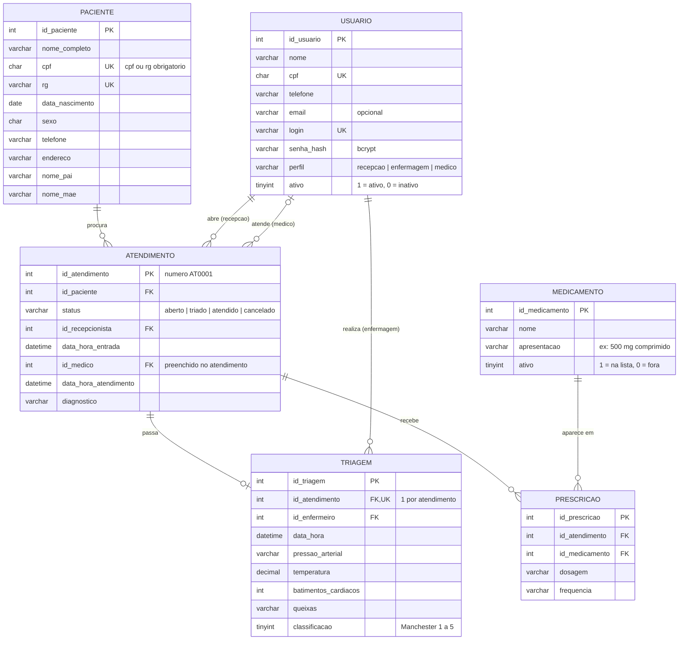

# MER — Sistema de Atendimento de Pronto Socorro

Banco MySQL, 6 tabelas: `usuario`, `paciente`, `atendimento`, `triagem`, `medicamento`, `prescricao`.

## Relacionamentos

| De | Para | Cardinalidade | Significado |
|---|---|---|---|
| paciente | atendimento | 1 : N | cada ida ao pronto-socorro é um atendimento novo |
| atendimento | triagem | 1 : 0..1 | cada atendimento passa por uma triagem (ainda não existe enquanto `aberto`) |
| atendimento | prescricao | 1 : N | o médico pode passar vários remédios |
| medicamento | prescricao | 1 : N | o mesmo remédio aparece em vários atendimentos |
| usuario (recepção) | atendimento | 1 : N | quem abriu o atendimento |
| usuario (enfermagem) | triagem | 1 : N | quem fez a triagem |
| usuario (médico) | atendimento | 0..1 : N | quem atendeu (vazio até atender) |

`atendimento` e `medicamento` são N : N, e a `prescricao` é a tabela que liga os dois, com a dosagem e a frequência.

## A esteira (campo `status` do atendimento)

| Etapa | Quem | Grava em | Status vira |
|---|---|---|---|
| Recepção | recepcionista | `paciente` + `atendimento` | `aberto` |
| Triagem | enfermagem | `triagem` | `triado` |
| Atendimento | médico | `prescricao` + diagnóstico no `atendimento` | `atendido` |

Pode virar `cancelado` antes de `atendido`. O histórico é uma consulta (`WHERE status = 'atendido'`), não uma tabela.

## Classificação (Protocolo de Manchester)

| Valor | Cor | Urgência |
|---|---|---|
| 1 | Vermelho | emergência |
| 2 | Laranja | muito urgente |
| 3 | Amarelo | urgente |
| 4 | Verde | pouco urgente |
| 5 | Azul | não urgente |
