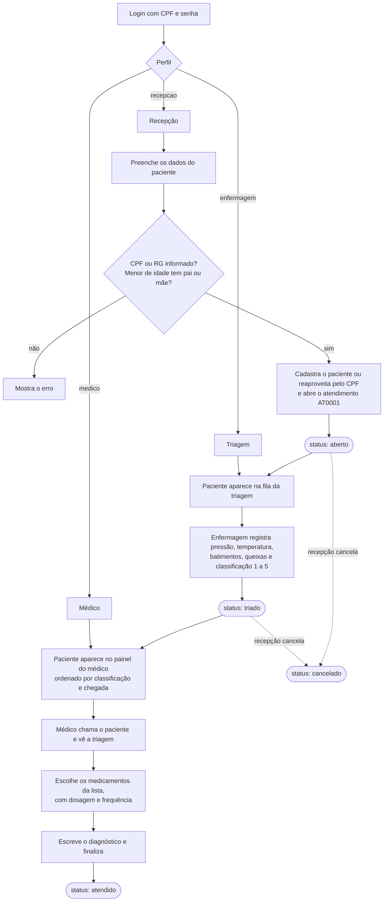
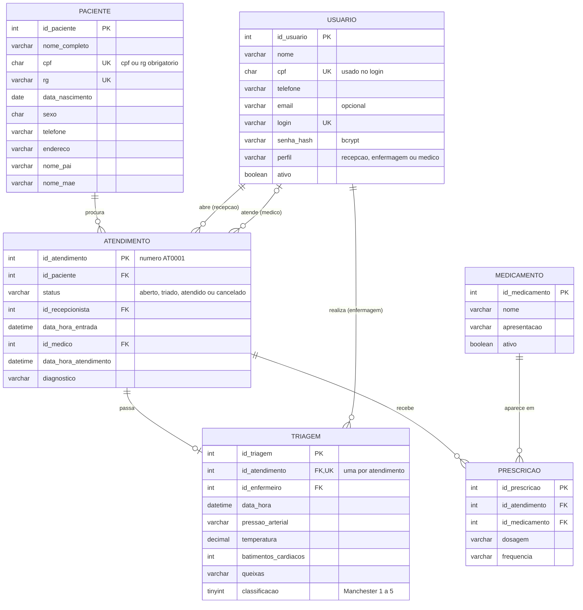

# Sistema de Atendimento de Pronto Socorro

Projeto Integrador 2 - Sistemas de Informação, PUC-Campinas.

Sistema para organizar o atendimento de um pronto socorro, desde a chegada do paciente na recepção até o atendimento médico. A recepção abre o atendimento, a enfermagem faz a triagem e classifica o risco pelo Protocolo de Manchester, e o médico atende os pacientes na ordem de prioridade.

O sistema roda no próprio computador e é aberto pelo navegador em `http://localhost:3000`.

## Tecnologias

- MySQL: banco de dados
- Node.js com Express: servidor (rotas, regras de negócio e conexão com o banco)
- JavaScript, HTML e CSS: telas

Bibliotecas do servidor: `express`, `mysql2` e `bcryptjs` (para guardar as senhas com hash).

## Estrutura de pastas

```
Projeto Integrador/
  bd/
    create_table.sql     cria o banco, as tabelas, os usuários de teste e os medicamentos
  backend/
    server.js            servidor e todas as rotas
    .env.example         modelo do arquivo de configuração do banco
    package.json
  frontend/
    login.html, recepcao.html, triagem.html, medico.html
    css/style.css
    js/login.js, recepcao.js, triagem.js, medico.js
  MER.md                 modelo do banco com mais detalhes
  Documentação           documento do projeto
```

## Como rodar

1. Instalar o Node.js e o MySQL 8.
2. Rodar o `bd/create_table.sql` no MySQL. Ele apaga e cria de novo o banco `pronto_socorro`.
3. Na pasta `backend`, copiar o `.env.example` para um arquivo `.env` e colocar a senha do seu MySQL.
4. Na pasta `backend`, rodar:
   ```
   npm install
   node server.js
   ```
5. Abrir `http://localhost:3000` no navegador.

O arquivo `.env` não vai para o GitHub, porque tem a senha do banco.

### Usuários de teste

Para testar, use um dos jogadores do Flamengo abaixo (5 em cada perfil). O login é feito com o CPF e a senha de cada um, e no banco fica só o hash da senha. A lista completa, com a equipe de 30 profissionais, está em `docs/usuarios_teste.txt`.

| Perfil | Nome | CPF (login) | Senha |
|---|---|---|---|
| Recepção | Leandro | 43141592608 | Leandro@2608 |
| Recepção | Andrade | 46283185223 | Andrade@5223 |
| Recepção | Adílio | 49424777868 | Adilio@7868 |
| Recepção | Gerson | 52566370451 | Gerson@0451 |
| Recepção | Everton Ribeiro | 55707963049 | Everton@3049 |
| Enfermagem | Júnior | 58849555610 | Junior@5610 |
| Enfermagem | Petkovic | 61991148259 | Petkovic@8259 |
| Enfermagem | Filipe Luís | 65132740871 | Filipe@0871 |
| Enfermagem | Bruno Henrique | 68274333403 | Bruno@3403 |
| Enfermagem | Pedro | 71415926018 | Pedro@6018 |
| Médico | Zico | 74557518699 | Zico@8699 |
| Médico | Romário | 77699111257 | Romario@1257 |
| Médico | Adriano | 80840703805 | Adriano@3805 |
| Médico | Arrascaeta | 83982296404 | Arrascaeta@6404 |
| Médico | Gabigol | 87123889045 | Gabigol@9045 |

## Processo do sistema

Cada profissional entra com o próprio CPF e cai na tela do seu perfil. O paciente passa pelas três etapas, e o campo `status` do atendimento mostra em que ponto ele está.



Resumo dos status:

| Status | Quem muda | Significado |
|---|---|---|
| aberto | recepção | paciente esperando a triagem |
| triado | enfermagem | paciente esperando o médico |
| atendido | médico | atendimento finalizado, vira histórico |
| cancelado | recepção | só pode cancelar antes de o médico atender |

### Classificação de Manchester

| Valor | Cor | Urgência |
|---|---|---|
| 1 | Vermelho | emergência |
| 2 | Laranja | muito urgente |
| 3 | Amarelo | urgente |
| 4 | Verde | pouco urgente |
| 5 | Azul | não urgente |

## Modelo de dados (MER)

São 6 tabelas: `usuario`, `paciente`, `atendimento`, `triagem`, `medicamento` e `prescricao`.



Observações sobre o modelo:

- Um paciente pode ter vários atendimentos, um para cada vez que vai ao pronto socorro.
- Cada atendimento tem no máximo uma triagem.
- A `prescricao` liga o atendimento ao catálogo de `medicamento`, com a dosagem e a frequência daquele paciente.
- O histórico não é uma tabela separada: são os atendimentos com status `atendido`.
- A senha do usuário é guardada só como hash bcrypt.
- O número `AT0001` não é gravado no banco: o servidor monta a partir do `id_atendimento`.

## Rotas do servidor

| Método | Rota | Tela | O que faz |
|---|---|---|---|
| POST | /login | Login | confere CPF e senha |
| POST | /usuarios | - | cadastra um profissional |
| POST | /atendimentos | Recepção | cadastra o paciente e abre o atendimento |
| GET | /atendimentos?busca= | Recepção | busca por número ou CPF |
| PUT | /atendimentos/:id | Recepção | altera os dados do paciente |
| PATCH | /atendimentos/:id/cancelar | Recepção | cancela o atendimento |
| GET | /triagem/fila | Triagem | lista os atendimentos abertos |
| POST | /atendimentos/:id/triagem | Triagem | grava a triagem |
| GET | /painel | Médico | lista os triados por prioridade |
| GET | /medicamentos | Médico | lista os medicamentos |
| GET | /atendimentos/:id/prescricoes | Médico | lista os medicamentos já passados |
| POST | /atendimentos/:id/prescricoes | Médico | passa um medicamento |
| PATCH | /atendimentos/:id/finalizar | Médico | grava o diagnóstico e finaliza |

## Regras de negócio

- O paciente precisa ter CPF ou RG.
- Paciente menor de 18 anos precisa ter o nome do pai ou da mãe.
- Se o CPF já está cadastrado, o paciente é reaproveitado e só um atendimento novo é aberto.
- A triagem só pode ser feita em atendimento aberto.
- O médico só prescreve e finaliza atendimento triado.
- Atendimento atendido não pode ser alterado nem cancelado.
- Só usuário ativo consegue entrar no sistema.
