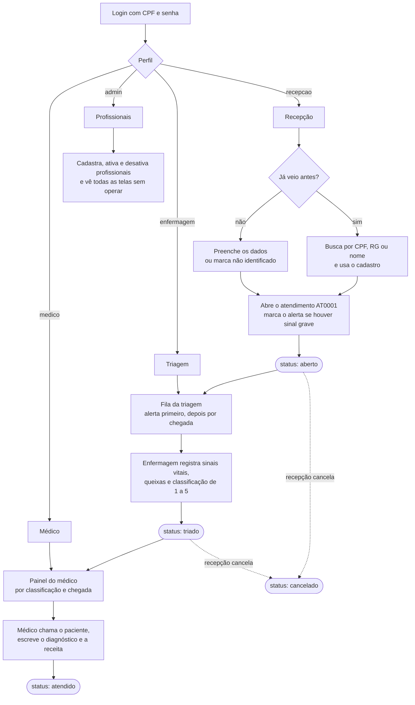
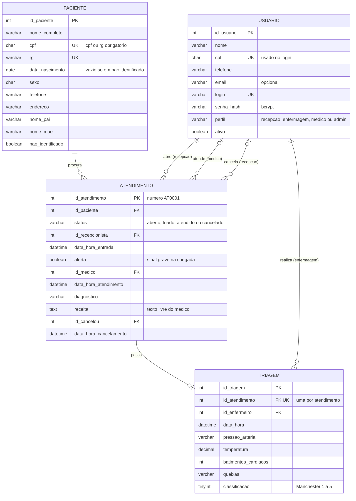

# Sistema de Atendimento de Pronto Socorro

Projeto Integrador 2 - Sistemas de Informação, PUC-Campinas.

Sistema para organizar o atendimento de um pronto socorro, desde a chegada do paciente na recepção até o atendimento médico. A recepção abre o atendimento, a enfermagem faz a triagem e classifica o risco pelo Protocolo de Manchester, e o médico atende os pacientes na ordem de prioridade. Um administrador cadastra os profissionais e acompanha todas as telas.

O sistema roda no próprio computador e é aberto pelo navegador em `http://localhost:3000`.

## Tecnologias

- MySQL 8.0.16 ou mais novo: banco de dados
- Node.js 20.12 ou mais novo, com Express: servidor (rotas, regras de negócio e conexão com o banco)
- JavaScript, HTML e CSS: telas

Bibliotecas do servidor: `express`, `mysql2`, `bcryptjs` (para guardar as senhas com hash) e `express-session` (para saber quem está logado).

## Estrutura de pastas

```
Projeto Integrador/
  bd/
    create_table.sql      cria o banco, as 4 tabelas e os usuários de teste
  backend/
    server.js             liga o servidor e as rotas
    banco.js              conexão com o MySQL
    exigir.js             porteiro das rotas: confere login, usuário ativo e perfil
    apoio.js              regras e funções que se repetem (idade, número AT, validações, filtros)
    .env.example          modelo do arquivo de configuração do banco
    package.json
    rotas/
      login.js            login e logout
      recepcao.js         pacientes, atendimentos e histórico da recepção
      triagem.js          fila, triagem e histórico da triagem
      medico.js           painel, finalizar e histórico do médico
      admin.js            cadastro e situação dos profissionais
  frontend/
    login.html, recepcao.html, triagem.html, medico.html, profissionais.html
    historico-recepcao.html, historico-triagem.html, historico-medico.html
    css/style.css
    js/                   um arquivo por tela, mais menu-admin.js (menu do administrador)
  MER.md                  modelo do banco com mais detalhes
  docs/
    Documentação          documento do projeto
```

## Como rodar (Windows)

1. Instalar o Node.js, o MySQL Server e o MySQL Workbench.
2. Abrir o `bd/create_table.sql` no Workbench e executar. Ele apaga e cria de novo o banco `pronto_socorro`, com os usuários de teste.
3. Na pasta `backend`, copiar o `.env.example` para um arquivo `.env` e colocar a senha do seu MySQL.
4. Na pasta `backend`, rodar:
   ```
   npm install
   node server.js
   ```
5. Abrir `http://localhost:3000` no navegador.

O arquivo `.env` não vai para o GitHub, porque tem a senha do banco.

### Usuários de teste

O login é feito com o CPF (só números) e a senha. No banco fica só o hash da senha. Os nomes são o elenco do Flamengo e os CPFs são inventados, só para teste. O script também cria 30 usuários genéricos da equipe, com a senha no padrão primeiro nome + `@` + 4 últimos dígitos do CPF.

| Perfil | Nome | CPF (login) | Senha |
|---|---|---|---|
| Recepção | Leandro | 43141592608 | Leandro@2608 |
| Recepção | Andrade | 46283185223 | Andrade@5223 |
| Recepção | Adílio | 49424777868 | Adilio@7868 |
| Recepção | Gerson | 52566370451 | Gerson@0451 |
| Recepção | Everton Ribeiro | 55707963049 | Everton@3049 |
| Enfermagem | Júnior | 58849555610 | Junior@5610 |
| Enfermagem | Petkovic | 61991148259 | Petkovic@8259 |
| Enfermagem | Filipe Luís | 65132740871 | Filipe@0871 |
| Enfermagem | Bruno Henrique | 68274333403 | Bruno@3403 |
| Enfermagem | Pedro | 71415926018 | Pedro@6018 |
| Médico | Zico | 74557518699 | Zico@8699 |
| Médico | Romário | 77699111257 | Romario@1257 |
| Médico | Adriano | 80840703805 | Adriano@3805 |
| Médico | Arrascaeta | 83982296404 | Arrascaeta@6404 |
| Médico | Gabigol | 87123889045 | Gabigol@9045 |
| Administrador | Jorge Jesus | 90265482137 | Jorge@2137 |

## Processo do sistema

Cada profissional entra com o próprio CPF e cai na tela do seu perfil. O paciente passa pelas três etapas, e o campo `status` do atendimento mostra em que ponto ele está.



Resumo dos status:

| Status | Quem muda | Significado |
|---|---|---|
| aberto | recepção | paciente esperando a triagem |
| triado | enfermagem | paciente esperando o médico |
| atendido | médico | atendimento finalizado, vira histórico |
| cancelado | recepção | só pode cancelar antes de o médico atender. Fica gravado quem cancelou e quando |

### Classificação de Manchester

| Valor | Cor | Urgência |
|---|---|---|
| 1 | Vermelho | emergência |
| 2 | Laranja | muito urgente |
| 3 | Amarelo | urgente |
| 4 | Verde | pouco urgente |
| 5 | Azul | não urgente |

### Alerta na chegada

Quem classifica o risco é a enfermagem. Mas um paciente com sangramento forte, desmaio, falta de ar ou dor no peito não pode esperar atrás de quem chegou antes com um caso leve. Por isso a recepção pode marcar o **alerta** ao abrir o atendimento (ou depois, pelo Alterar, enquanto ele ainda espera a triagem). Na fila da triagem, quem tem alerta aparece primeiro e destacado. A cor continua sendo dada só pela enfermagem, e depois da triagem quem manda é a classificação.

### Paciente não identificado

Quem chega desacordado ou sem conseguir informar os dados é aberto como **não identificado**: só o sexo é obrigatório, e o nome fica "Não identificado". Quando a pessoa for identificada, a recepção completa os dados pelo Alterar. Se o CPF ou o RG digitado já for de um cadastro que existe, o atendimento passa a ser ligado a esse cadastro, e o provisório é apagado.

## Telas por perfil

| Perfil | Tela | O que faz |
|---|---|---|
| Recepção | Recepção | busca paciente (CPF, RG ou nome), abre atendimento, marca alerta ou não identificado, consulta, altera e cancela |
| Recepção | Histórico | atendimentos encerrados (atendidos e cancelados), só leitura |
| Enfermagem | Triagem | fila de espera com busca, faz a triagem |
| Enfermagem | Histórico | triagens de atendimentos encerrados, só leitura |
| Médico | Painel | pacientes triados por prioridade, com busca. Chama o paciente, escreve diagnóstico e receita e finaliza |
| Médico | Histórico | atendimentos finalizados, só leitura |
| Administrador | Profissionais | cadastra profissionais, lista a equipe, ativa e desativa |
| Administrador | todas as outras | vê todas as telas, sem nenhum botão de ação |

Os históricos abrem mostrando o dia de hoje e têm filtros de data, número do atendimento, status ou classificação. Mostram no máximo 200 linhas.

## Modelo de dados (MER)

São 4 tabelas: `usuario`, `paciente`, `atendimento` e `triagem`.



Observações sobre o modelo:

- Um paciente pode ter vários atendimentos, um para cada vez que vai ao pronto socorro.
- Cada atendimento tem no máximo uma triagem.
- Cada etapa grava quem fez e quando: `id_recepcionista`, `id_enfermeiro`, `id_medico` e `id_cancelou`.
- A receita é um texto livre que o médico digita ao finalizar, guardado no próprio `atendimento`.
- O histórico não é uma tabela separada: são os atendimentos com status `atendido` ou `cancelado`.
- A senha do usuário é guardada só como hash bcrypt.
- O número `AT0001` não é gravado no banco: o servidor monta a partir do `id_atendimento`.

## Login e acesso

- Os profissionais são cadastrados pelo administrador na tela Profissionais. Os de teste já vêm no `create_table.sql`.
- No login, o servidor guarda o usuário numa sessão (`express-session`) e o navegador recebe um cookie `httpOnly` e `sameSite: strict`.
- A cada pedido, o `exigir.js` confere três coisas: se está logado (401), se o usuário continua ativo no banco (401, e a sessão é apagada) e se o perfil pode usar a rota (403). Se o administrador desativar alguém no meio do plantão, o próximo clique dessa pessoa já é barrado.
- Quem abriu, triou, atendeu ou cancelou é gravado a partir da sessão, e não de um dado mandado pela tela.
- O administrador pode **ler** as telas dos outros perfis, mas as rotas que gravam só aceitam o perfil dono. Ele não se desativa.
- Sair apaga a sessão. Reiniciar o servidor desloga todo mundo.

## Rotas do servidor

| Método | Rota | Perfil | O que faz |
|---|---|---|---|
| POST | /login | todos | confere CPF e senha e abre a sessão |
| POST | /logout | todos | apaga a sessão |
| GET | /pacientes?tipo=&busca= | recepção | busca paciente por CPF, RG ou nome |
| POST | /atendimentos | recepção | abre o atendimento (cadastra o paciente se for novo) |
| GET | /atendimentos?tipo=&busca= | recepção, admin | consulta por número ou CPF. Sem busca, lista os em andamento |
| PUT | /atendimentos/:id | recepção | altera os dados do paciente e o alerta |
| PATCH | /atendimentos/:id/cancelar | recepção | cancela e grava quem cancelou |
| GET | /recepcao/historico | recepção, admin | histórico da recepção |
| GET | /triagem/fila | enfermagem, admin | fila de espera, com filtro |
| POST | /atendimentos/:id/triagem | enfermagem | grava a triagem |
| GET | /triagem/historico | enfermagem, admin | histórico da triagem |
| GET | /painel | médico, admin | pacientes triados por prioridade, com filtro |
| PATCH | /atendimentos/:id/finalizar | médico | grava o diagnóstico e a receita e finaliza |
| GET | /medico/historico | médico, admin | histórico do médico |
| GET | /usuarios | admin | lista os profissionais |
| POST | /usuarios | admin | cadastra um profissional |
| PATCH | /usuarios/:id/ativo | admin | ativa ou desativa um profissional |

## Regras de negócio

- O paciente precisa ter CPF ou RG. O CPF tem 11 números, sem ponto e traço. A exceção é o paciente não identificado.
- Paciente menor de 18 anos precisa ter o nome do pai ou da mãe.
- Paciente que já veio antes é buscado pela recepção e escolhido com "Usar este paciente". O que a recepção mudar no formulário atualiza o cadastro. Paciente novo com CPF ou RG que já existe é barrado, para não duplicar o cadastro.
- Um paciente só pode ter um atendimento em andamento por vez.
- A triagem só pode ser feita em atendimento aberto. Temperatura de 30 a 45, batimentos de 0 a 300 e classificação de 1 a 5.
- O médico só finaliza atendimento triado.
- Atendimento atendido não pode ser alterado nem cancelado.
- Quando dois profissionais agem no mesmo atendimento ao mesmo tempo (por exemplo, o médico finaliza enquanto a recepção cancela), só o primeiro vale. O `UPDATE` confere o status antes de gravar.
- Só usuário ativo consegue entrar no sistema.

## Segurança

- Todo SQL usa parâmetros (`?`), contra SQL injection.
- Senhas guardadas só com hash bcrypt.
- O perfil é conferido no servidor em toda rota, e não só escondido na tela.
- As telas mostram os dados como texto puro (`textContent`), contra código malicioso digitado num nome.
- CPF inexistente e senha errada dão a mesma mensagem, para ninguém descobrir quais CPFs existem.
- A senha do banco fica no `.env`, que está no `.gitignore`.
