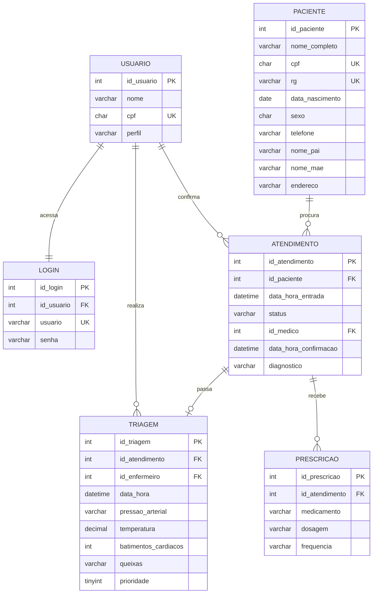

# Sistema de Atendimentos de Pronto Socorro

Sistema para controle do fluxo de atendimento em um Pronto Socorro, da chegada do paciente na recepção até a confirmação da consulta médica. Projeto Integrador 2 — Sistemas de Informação, PUC-Campinas.

Roda local, no próprio computador, aberto pelo navegador em `http://localhost:3000`. Não é site publicado e não precisa de internet.

## O processo

1. **Recepção** — cadastra o paciente e abre o atendimento, que recebe um número (ex: `AT0001`). Também consulta, altera e cancela.
2. **Triagem (Enfermagem)** — registra os sinais vitais e classifica o risco conforme o Protocolo de Manchester.
3. **Médico** — chama os pacientes por prioridade, lança as medicações e confirma a consulta com o diagnóstico.

Cada tela exige login. O perfil do usuário (`recepcao`, `enfermagem` ou `medico`) define qual tela ele abre.

## Tecnologias

```
MySQL  →  Node.js (Express)  →  JavaScript  →  HTML  →  CSS
```

| Camada | O que faz |
|---|---|
| MySQL | Guarda os dados (`create_table.sql`) |
| Node.js + Express | `backend/server.js`: rotas, regras de negócio e conexão com o banco (pacote `mysql2`) |
| JavaScript | Um arquivo por tela, chama o back com `fetch` e troca dados em JSON |
| HTML + CSS | As 4 telas: login, recepção, triagem e médico |

## Estrutura

```
Projeto-Integrador2/
  create_table.sql        cria o banco, as tabelas e os logins de teste
  iniciar.bat             dois cliques: sobe o servidor e abre o navegador
  backend/
    server.js
    package.json
    public/
      login.html
      recepcao.html
      triagem.html
      medico.html
      css/style.css
      js/login.js, recepcao.js, triagem.js, medico.js
```

## Como rodar

1. Instalar o [Node.js](https://nodejs.org) e o MySQL 8.
2. Rodar o `create_table.sql` no MySQL. Ele cria o banco `pronto_socorro` e três logins de teste:

   | Usuário | Senha | Tela |
   |---|---|---|
   | `recepcao` | `123` | Recepção |
   | `enfermagem` | `123` | Triagem |
   | `medico` | `123` | Médico |

3. Se o MySQL não usar usuário `root` e senha `root`, ajustar no topo do `backend/server.js`.
4. Dar dois cliques no `iniciar.bat`. Na primeira vez ele instala os pacotes (`npm install`).

## Modelo de dados

6 tabelas: `usuario`, `login`, `paciente`, `atendimento`, `triagem`, `prescricao`.



### Notas do modelo

- `usuario` guarda o profissional; `login` guarda usuário e senha, um login por usuário.
- `paciente` exige pelo menos um documento: `cpf` ou `rg` (CHECK). Menor de 18 anos precisa de `nome_pai` ou `nome_mae`, validado no back-end.
- `atendimento.status` controla o fluxo: `aberto` → `triado` → `confirmado` (ou `cancelado`).
- O número `AT0001` não é gravado no banco: o back-end monta a partir do `id_atendimento`.
- `triagem` é 1:1 com `atendimento` (`id_atendimento` é `UNIQUE`).
- `prioridade` guarda Manchester como número: 1 vermelho, 2 laranja, 3 amarelo, 4 verde, 5 azul. Assim o painel do médico ordena direto no SQL.
- `prescricao` é 1:N, um atendimento pode ter várias medicações.

## Rotas do back-end

| Método | Rota | Tela | O que faz |
|---|---|---|---|
| POST | `/login` | Login | Confere usuário e senha |
| POST | `/atendimentos` | Recepção | Cadastra paciente (ou reaproveita pelo CPF) e abre atendimento |
| GET | `/atendimentos?busca=` | Recepção | Busca por número ou CPF |
| PUT | `/atendimentos/:id` | Recepção | Altera os dados do paciente |
| PATCH | `/atendimentos/:id/cancelar` | Recepção | Cancela, se ainda não foi confirmado |
| GET | `/triagem/fila` | Triagem | Lista atendimentos abertos |
| POST | `/atendimentos/:id/triagem` | Triagem | Grava sinais vitais e prioridade |
| GET | `/painel` | Médico | Lista triados por prioridade e hora da triagem |
| GET | `/atendimentos/:id/prescricoes` | Médico | Lista as medicações lançadas |
| POST | `/atendimentos/:id/prescricoes` | Médico | Lança medicação |
| PATCH | `/atendimentos/:id/confirmar` | Médico | Confirma a consulta com o diagnóstico |
